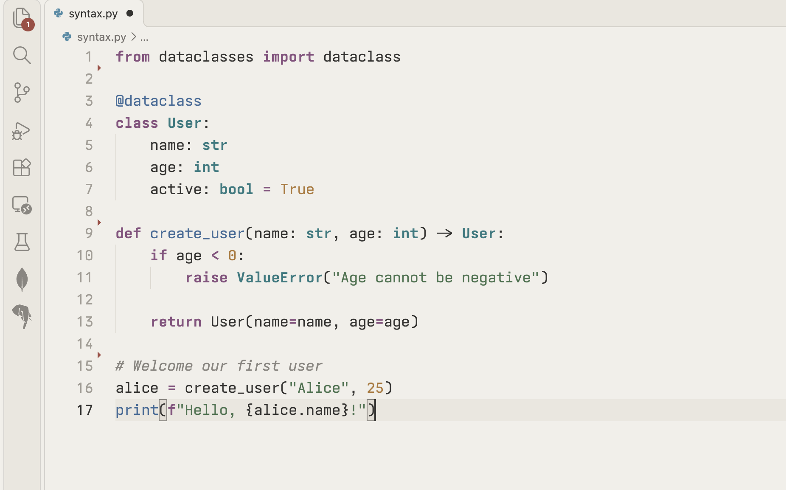

# Paper Dust

**A quieter place to code.**

Paper Dust is a warm, minimal light theme for Visual Studio Code, designed to make your coding environment feel calm, comfortable, and distraction-free.

Inspired by the simplicity of paper, it combines soft neutral backgrounds with thoughtful syntax colours.

## Features

- **Warm paper-inspired background** — gentle off-white tones instead of harsh white.
- **Thoughtful syntax highlighting** — carefully selected colours for keywords, functions, strings, and types.
- **Subtle visual hierarchy** — bold keywords and type declarations improve readability.
- **Minimal interface** — soft borders, quiet panels, and understated selections.
- **Consistent terminal colours** — a matching palette for the integrated terminal.
- **Semantic highlighting** — richer syntax highlighting in supported languages.

## Preview

### TypeScript

### Python

## Installation

Once published, Paper Dust will be available through the Visual Studio Code Extensions Marketplace.

1. Open Visual Studio Code.
2. Open Extensions (`Cmd/Ctrl + Shift + X`).
3. Search for **Paper Dust**.
4. Select **Install**.
5. Open **Preferences: Color Theme** and choose **Paper Dust**.

## Supported languages

Paper Dust uses VS Code's syntax and semantic highlighting systems, supporting languages such as TypeScript, JavaScript, Python, HTML, CSS, and JSON.

## Philosophy

A coding environment should help you focus, not compete for your attention.

Paper Dust keeps the interface quiet while giving important parts of your code just enough colour and emphasis to stand out.

## License

MIT License.

---

_Made for those who prefer a quieter place to code._
