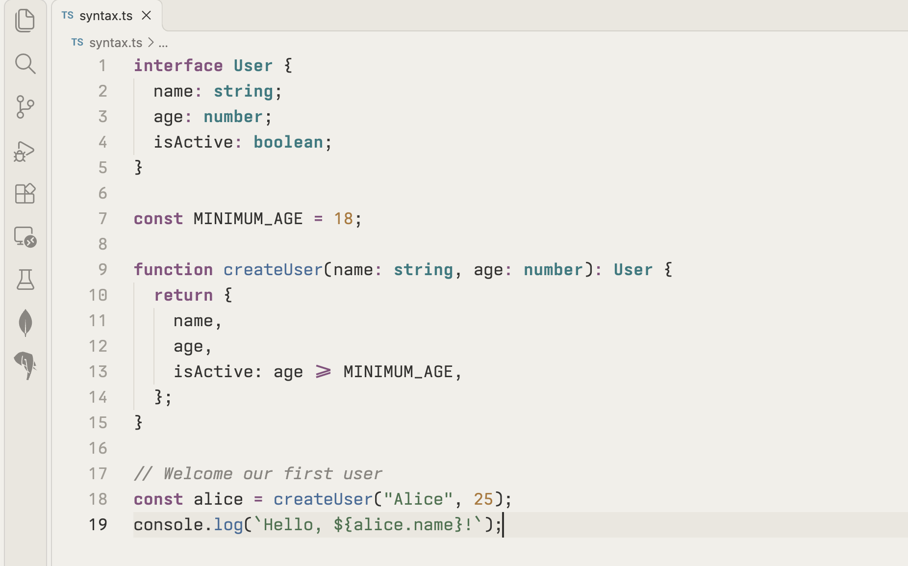

# Paper Dust

**A quieter place to code.**

Paper Dust is a minimal light theme for Visual Studio Code.

I've always preferred light themes, but most feel a little too bright for my taste. I wanted something softer, with warm, paper-like backgrounds, subtle colours, and enough contrast to keep code easy to read.

That's how Paper Dust came about.

## Features

- **Warm backgrounds.** Soft off-white tones instead of bright white.
- **Subtle syntax colours.** Muted colours for keywords, functions, strings, and types.
- **Better readability.** Bold keywords and type names help important parts of your code stand out.
- **A consistent interface.** Matching colours across the editor, sidebar, tabs, menus, and notifications.
- **Matching terminal.** A terminal palette that feels at home with the rest of the theme.
- **Semantic highlighting.** More accurate syntax colouring in languages that support it.

## Preview

### TypeScript



### Python


## Installation

You can install Paper Dust directly from the [VS Code Marketplace](https://marketplace.visualstudio.com/items?itemName=paper-dust.paper-dust).

1. Open VS Code.
2. Go to Extensions (`Cmd/Ctrl + Shift + X`).
3. Search for **Paper Dust** and install it.
4. Open **Preferences: Color Theme** and select **Paper Dust**.

Or install it from the terminal:

```bash
code --install-extension paper-dust.paper-dust
```

## Language support

Paper Dust works with VS Code's syntax highlighting system, including languages such as TypeScript, JavaScript, Python, HTML, CSS, and JSON.

Other languages should work too, although colours may vary depending on their syntax support.

## Feedback

This is my first VS Code theme, and I'm still refining it.

If something looks out of place or you have an idea for improving it, feel free to [open an issue](https://github.com/bbcparfait/paper-dust/issues).

Feedback and contributions are always welcome.

## License

Paper Dust is free and open source under the [MIT License](LICENSE).

---

_Made for those who like their code with a little less brightness._
